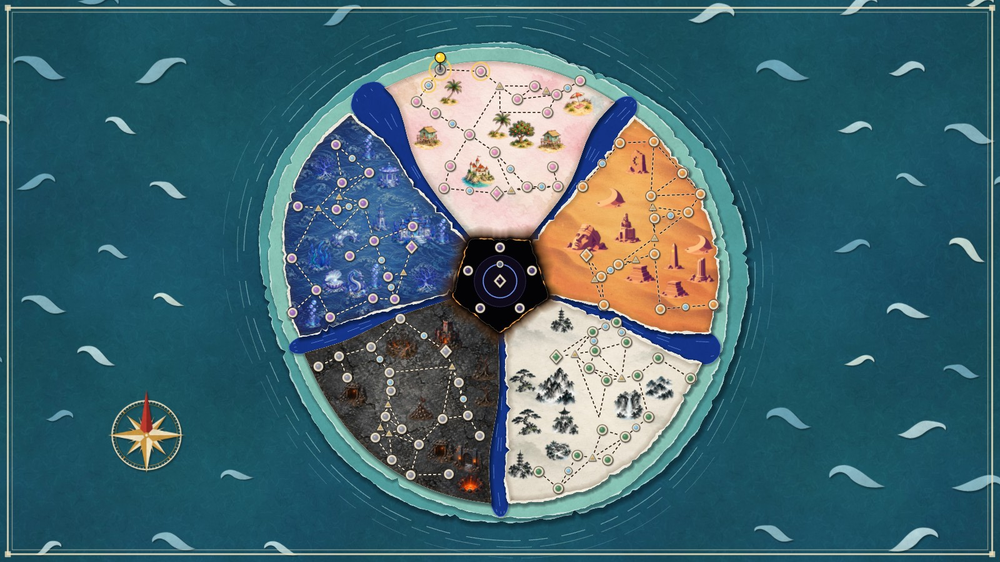
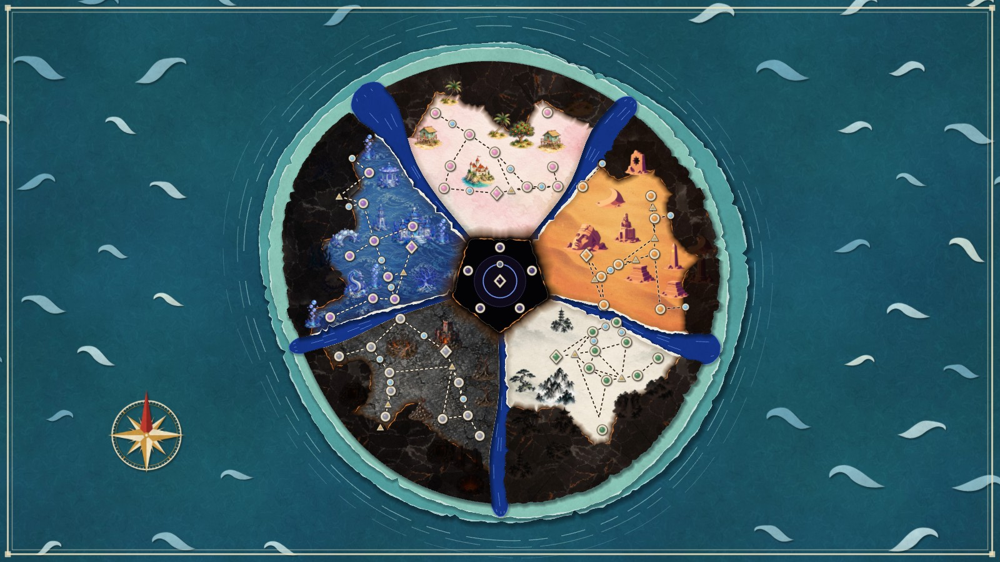
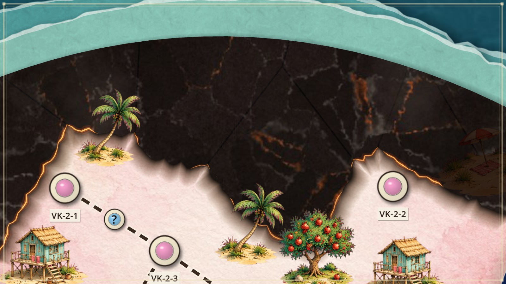

# The overworld as torn storybook pages — method

*A demo and the method behind it. Status: a third view of the generated map, off by default
(`MapGDD.md` §11a); the art kits are AI-made placeholders. Captures in
`Docs/Art/Overworld/captures/`. Everything below describes what is built and measured, not a
plan — except §9 and §10, which say so.*

## 0. The question, and the answer

> "The main map must be procedurally random, but every region still has to keep its own
> style. How do we create art assets so every generated map *feels like a map* while each
> region keeps its style?"

**Split the picture in two, and never let the halves trade places.**

- **What makes it a map is code.** The desk, the sea's cut-paper waves, the shallows, the
  rivers, the torn edge of every page, the burnt hole, the compass, the pins, the dotted
  roads, the frame. These are the same on every island and are computed from the generated
  shapes — so *any* seed gets them, and they can never look out of place.
- **What makes it a realm is a kit.** One ground, nine symbols, one of them the seat — in
  that world's medium. A kit is art, it belongs to one world, and it is replaced file by
  file. It knows nothing about any particular island.

The generator supplies shapes; the shared layer turns shapes into paper; the kit prints the
paper. No asset is ever painted *for* a map, so no map can outrun the art.

The fiction does the rest: Fableland's worlds are storybooks from different shelves
(`RealmStyleBible.md` §0), so the island is **five pages torn from five books, laid
together on a desk of sea-coloured paper**. The tears between pages are the rivers. The
VOID is a hole burnt through all of them, and its 45-day advance is the paper charring
inward from the rim.



## 1. What is built

| | |
|---|---|
| Demo | `res://Scenes/Dev/OverworldArtDemo.tscn` — any seed, "New seed", a day slider (1 → 45+), pan / zoom / `F` to fit; toggles for symbols, torn edges, mist, labels, the atlas side by side, MSAA |
| In the game | the map's **View** button now cycles *atlas → schematic → pages*. The game still opens on the atlas. |
| Renderer | `Scripts/Map/Pages/` — `PageModel` (everything precomputed), `OverworldPageView` (the node tree and the three things that redraw), `PaperCut` (tearing and meshes), `PageKit` (kit and furniture loading) |
| Kit pipeline | `Tools/overworld_art/build_kits.py` (per-world kits) and `shared.py` (the furniture) |
| Assets | `Assets/Sprites/Map/Overworld/<W>/` × 8 and `_shared/` — **95 files, 5.09 MB** |

Run the demo, or photograph it (it needs a window; `open -g` keeps it in the background):

```bash
Godot --path . res://Scenes/Dev/OverworldArtDemo.tscn
open -g -n -W -a /Applications/Godot_mono.app --args --path "$PWD" --resolution 1600x900 \
     res://Scenes/Dev/OverworldArtDemo.tscn -- --shots=/abs/dir [--seeds=A,B,C,D] [--map]
```

`--map` also photographs the real Map scene switched to its pages view; it points the save
service at a scratch folder first, so no slot of yours is opened.

## 2. What makes any island read as a map (code — identical on every run)

Back to front. Each row is drawn by code from the generated geometry; none of it knows
which worlds were drawn.

| # | Layer | What it is | Why it is there |
|---|---|---|---|
| 1 | **Desk** | sea-coloured paper (`desk.jpg`, tiled), a little lighter under the island | the ground the collage lies on; says "this is an object on a table" |
| 2 | **Ripple lines** | three broken rings in pale gouache, following the coast at 86 / 108 / 134 px | borrowed from the cartographer: the oldest sign for "coast" |
| 3 | **Cut-paper waves** | rows of white cut paper tinted in four sea papers, each with a shadow | a paper theatre's sea; fills the empty desk without competing with the island |
| 4 | **Compass rose** | cream, ochre and red cut paper; north is the long red point | the one object that says "map" from across a room. No letters. |
| 5 | **Shallows** | two sheets of sea-green paper torn a little larger than the island | the coast's halo; separates page from desk at any zoom |
| 6 | **River paper** | a strip of deep blue under both neighbouring pages, ending in a short tongue on the shallows | the tear between two pages *is* the river — blue shows through |
| 7 | **Pages** | per realm: soft shadow, white deckle, the kit's ground clipped to the realm's shape, a little foxing at the edge | the realm itself; the torn edge is what makes it paper |
| 8 | **Char** | devoured fields: the page darkened, cracked char over it, a bitten and glowing frontier | the VOID's clock, drawn as fire on paper (§7) |
| 9 | **Symbols** | the kit's nine pictures, scattered (§6) | the only layer that is *art per world* besides the ground |
| 10 | **Roads** | ink dashes with a casing; a Bridge of Eidolon is a violet thread pulled between two pins | dotted roads are map language; thread is not printed on any page, so it reads as "not of this world" |
| 11 | **Mist** | a sheet of tracing paper over each unexplored realm | hides nodes and roads, keeps the page's colour and pattern (§7) |
| 12 | **The hole** | scorch, a scalloped black edge, an ash lip, embers that breathe; zone 6 inside it | the VOID, burnt through every page |
| 13 | **Pins** | a cream paper sticker in the node kind's shape, an enamel head in the node's colour; names on slips of paper | the gameplay layer: must win against everything under it |
| 14 | **Frame** | a thin double neatline with corner squares | closes the picture |

**The torn edge** is the piece that had to be procedural, because it follows a shape nobody
has seen before. `PaperCut.Tear` takes any simple outline and a seeded stream and returns
two outlines with the same point count — the fibre edge, and a little inside it the line
where the printed surface stops:

1. shrink the outline by 6 px (rounded corners) and drop a point every 2.6 px;
2. push each point along its normal by three scales of looping noise — a slow wander
   (±3.8 px over ~90 px), a ragged middle (±3 px over ~15 px), a fine tooth (±0.9 px) — biased
   inward so a page never grows past its bank, plus a deeper nick about every 125 px;
3. the print edge follows the slow wander but only a third of the rag, and stands
   1.9 – 8.8 px further in: that band of bare fibre is the deckle, and it varies in width
   the way a real tear does;
4. a pin near the bank keeps a tab of paper under it (the tear is let back out round it,
   never past the original outline);
5. if the result folds over itself (the triangulator refuses it), halve the roughness and
   tear again — a sheet always comes back.

From the two outlines come three meshes: the print (triangulated, textured with the
ground), the deckle (a band between them, plus 0.9 px of soft fuzz), and the shadow (a
sliver to the lower right and a feather beyond it). The shallows and the river strips are
torn by the same function with looser or cleaner settings. "Torn edges" in the demo turns
all of it off, for comparison.

Light is from the upper left everywhere — it has to be, because the kits' symbols are lit
that way — so every shadow falls to the lower right, and nothing is ever mirrored (a
mirrored wave would throw its shadow the wrong way; the wave sheet holds each shape twice).

**No lettering is drawn into the art.** Node names are the game's own text on slips of
paper, shown only once zoomed in far enough to read; the event pin's `?` is the game's font.

## 3. What carries a realm's identity (art — one kit per world)

A **page kit** is three things:

| Part | File | What it must be |
|---|---|---|
| **Ground** | `ground.jpg`, 1024 × 1024 | The page's surface seen flat from directly above, in the world's medium. Full bleed, evenly lit, no horizon, no objects, no lettering. *Calm*: a 12 px pin and a dashed road must read on it. Slightly lighter toward the middle. It is **not tiled** — one copy spans the whole realm (about 700 world px), upright — so it need not be seamless. |
| **Nine symbols** | `stamp_0.png … stamp_8.png`, ≤ 256 px on the long side | Map symbols in the same medium: raised three-quarter view, each standing on its own small patch of ground, lit from the upper left, drawn at a matching scale, transparent outside. No lettering — not even a blank-looking sign. |
| **The seat** | one of the nine (`"seat"` in `kit.json`) | The world's capital landmark — castle, colossus, great peak, keep, saloon, dragon palace, pumpkin castle, pyramid. It is drawn half again as large as the rest and stands at the realm's LV4 city. |

**The originals** a kit is built from are two square PNGs, 1024 × 1024:
`KIT-<W>-G.png` (the ground) and `KIT-<W>-S.png` — the nine symbols in a **3 × 3 grid on one
flat key colour, magenta `#FF00FF`**, each centred in its cell with wide margins, nothing
touching, no shadow on the background, the seat anywhere (it is named in data). Magenta
because no medium here is built on it; a kit whose palette *is* pink or purple still keys,
with its despill held to the edge (§4). The originals are not in git (0.9 – 2.3 MB each,
28 MB for the sixteen); `build_kits.py --src DIR` says where they are.

**What the nine should cover**, so a page can be dressed whatever its shape:

- 1 seat, with the tallest or widest silhouette of the sheet;
- 2 – 3 built landmarks (tower, gate, shrine, monument);
- 2 – 3 pieces of terrain or growth (a tree, a rock, a hill, a dune) — these are what fill
  the page, so they must not look odd repeated;
- 1 – 2 small things, at most half the seat's size, for the gaps between roads;
- optionally, things that stand in water — mark them `coast` and they are only placed in
  the outer third of the realm (Vanilla's lighthouse, sailboat, headland, fishing village).

Avoid: lettering; a symbol that needs a particular neighbour (a bridge wants a river it
will not get); thin lattices with background showing through (cage bars, gates) — they key
poorly; anything pink or purple right at the silhouette unless the medium owns that colour.

`kit.json` (written by the pipeline; the only file the renderer reads besides the images):

```json
{
  "world": "VK", "name": "VanillaKindom", "medium": "storybook watercolour",
  "ground": "ground.jpg", "groundLuma": 0.855, "groundMean": "#efd5cd",
  "tone": "light",                       // dark pages get pale road ink, light pages dark ink
  "ink": "#3a2a20", "inkCase": "#fff7e6",
  "seat": 0,
  "stamps": [
    { "file": "stamp_0.png", "name": "a cream seaside castle with red roofs",
      "w": 256, "h": 244,                // the stored picture
      "sheetW": 335, "sheetH": 319,      // its size on the original sheet: relative scale
      "anchor": [0.5087, 0.9191],        // where it stands, 0..1 of the picture
      "foot": 0.9453,                    // width of its ground patch
      "band": "any" }                    // or "coast"
  ]
}
```

**Replacing art.** Any file can be swapped for a hand-made one of the same name; if its
size or standing point changes, edit its entry (or put the new originals in and re-run the
pipeline). `"ground"` names the file, so a PNG ground is fine. A world with **no kit** is
meant to be drawn anyway — its page as plain paper in the world's atlas tint, with no
symbols — so a new world is playable before its kit exists. That path is written but has
never run: all eight pool worlds have kits.

*Two departures from the brief's file names, both for weight:* the ground is `ground.jpg`
(eight 1024 px PNGs of paper grain are 15 MB; as JPEG at quality 90 they are 2.7 MB, and at
512 px the fine marks — scratchboard lines, pixels, hatching — go soft when zoomed in), and
eight of each kit's nine stamps are 8-bit palette PNGs with alpha (a quarter of the bytes;
the seat keeps every colour).

## 4. The recipe that made these kits (reproducible)

**Model:** GPT Image 2.5 in Tripo Studio (web), 1024 × 1024, one image per prompt, first
result kept. **Sixteen prompts** — two per world — from two templates; the per-world slots
are in `Tools/overworld_art/kit_prompts.json` and
`python3 Tools/overworld_art/build_kits.py --prompts [W …]` prints them filled in (checked
word for word against the generation manifest).

Ground:

> `{lead}` — a flat top-down background texture for an illustrated map, filling the whole
> square frame edge to edge, evenly lit, no horizon, no perspective, no objects, no
> buildings, no text. `{description}` It must read as one continuous `{sheet}`: subtle
> variation only, slightly lighter toward the middle, usable as a ground behind small map
> symbols.

Symbols:

> `{style}` map symbols — a sprite sheet of nine separate map symbols for an illustrated
> fantasy map, arranged in a clean 3 by 3 grid, each symbol centred in its cell with wide
> empty margins and nothing touching or overlapping. Background: one perfectly flat solid
> magenta (#FF00FF), no texture, no gradient, no shadows on the background, no grid lines,
> no frame. Each symbol is seen from a raised three-quarter view as on a hand-illustrated
> map, sitting on its own small patch of ground, all lit from the upper left, all at a
> matching scale. Symbols: `{nine symbols}`. Medium: `{medium}`. Palette: `{palette}`. No
> text, no lettering, no numbers.

Example slots (Vanilla): lead *"Pale pink and cream watercolour wash on cold-press paper"*;
style *"Storybook-watercolour"*; medium *"storybook watercolour and ink, loose washes, a
dark-brown ink line that breaks"*; palette *"vanilla cream, strawberry pink, coral, teal,
warm sand, coastal green"*; symbols *"a cream seaside castle with red roofs, a leaning palm
tree, a beach hut on stilts, a striped lighthouse, a small sailboat, a sand dune with a
parasol, a pomegranate tree heavy with red fruit, a rocky headland, a tiny fishing
village"*.

**Post-process** (`build_kits.py`; about 27 s for all eight; the same originals give the
same bytes):

1. **Matte.** A chroma-difference key: for key colour K (r = b high, g low),
   `1 − (min(r, b) − g) / (min(Kr, Kb) − Kg)`. It is exact for ink, greys, greens and golds.
   A purple or pink foreground reads as part-transparent, so anything further than three
   pixels from pure key is forced opaque — unless it is nearly the key colour itself, which
   is background seen through a gap (between columns, bars, coral).
2. **Un-mix and despill.** Colour is un-mixed from the key (`F = (C − (1 − a)·K) / a`);
   what magenta-hued paint is left is pulled back to neutral — only in the band beside the
   key for a medium that owns pinks and purples (`edge`: Starland, Loong, the Forgotten),
   everywhere for one that does not (`all`: the model bounces magenta light onto grey
   stone and green leaves).
3. **Erode** the crisp mattes by half a pixel. **Not the ink wash:** its symbols dissolve
   into white mist, which is paper — that sheet keeps the raw key, exact for achromatic
   paint, and stays soft.
4. **Cut** into rows, then each row into columns (symbols in different rows overhang the
   same column line), **trim** to the paint with a 3 px margin, scale so the long side is
   256 px (in premultiplied alpha).
5. **Measure** where each symbol stands: its ground patch is the lowest fifth of its
   paint; the anchor is that patch's centre, a little above its front edge.
6. **Halo** (the scratchboard only): a faint moonlight glow outside the paint, because a
   black shape on a black board cannot be found otherwise.
7. **Write**: the seat as true-colour PNG, the other eight as 255-colour palette PNGs
   (k-means in premultiplied RGBA, ordered dither), the ground as a quality-90 JPEG, and
   `kit.json`.

`--sheet DIR` also writes a review sheet per world — every stamp on dark, on white and on
its own ground, anchors marked. A fringe shows on one of the three.

**What the model got wrong, and what was done:** the Dark Wood's sheet came back with the
tree first and the castle second (the seat is data, not a position); magenta bounce light
baked into several sheets (the despill above); backgrounds seen *through* a pavilion and a
gate painted a shade off the key (the see-through rule); the pixel-art ground's pixels are
several times larger than its symbols' (not fixed — §8); the saloon's sign came back blank,
which is what was asked. Nothing was regenerated.

## 5. The shared furniture (code-drawn, no image model)

`Tools/overworld_art/shared.py` draws `desk.jpg`, `paper.png` (the grain every sheet is
this texture times a colour), `char.jpg`, `waves.png`, `compass.png` and `pins.png` — 0.36 MB,
in half a second, deterministic. They are placeholders of the same standing as the kits:
replace any of them by file name.

## 6. Placement rules (how a generated page is dressed)

All of it is decided once per generation, from streams of its own
(`seed + ":pages:tear:<W>"`, `…:stamps:<W>`, `…:shallows`, `…:river:<i>`, `…:hole`,
`…:ripples`, `…:waves`) — the `DetRandom.Sub` rule — so **the generator draws exactly the
numbers it drew before** and a seed's map is unchanged.

- **Ground:** one upright copy of the kit's square, spanning the page's bounding box.
- **Scale:** a symbol is 0.238 world px per pixel of its original sheet, so the kit's own
  relative sizes survive: a 300 px symbol is 71 world px — about 45 px on a 1600 × 900
  overview and 120 – 170 px zoomed into its realm. The seat is ×1.5.
- **The seat** stands at the realm's LV4 city. Six positions are tried (the pin at its
  gate, then left, right, below, and two corners) at three sizes; each is scored by what it
  would cover and whether it stays on the page, and the pin at the gate is worth a road or
  two crossing the picture.
- **The other eight** scatter by best-candidate sampling: each new symbol takes, of up to
  120 random spots, the legal one furthest from every symbol already placed — blue noise
  that fills the big gaps first. They are dealt from a shuffled bag, so every symbol
  appears before any repeats.
- **Legal** means: the body of its picture (its box less a margin for empty corners) on
  the printed page with 4 px to spare, probed at eight points; clear of the hole; no node
  under it (grown by the pin's radius); no road through it; no other symbol within 3 px.
- **Density thins toward the VOID:** a spot in the inner part of the realm is accepted
  only some of the time (16 % next to the hole, rising to always by 55 % of the way out).
- **Coast** symbols only in the outer 30 %.
- **How many:** the page's area ÷ 13 000 px², between 7 and 15; it stops after eight
  symbols in a row find no room. Measured: 44 – 56 symbols on an island.
- **Never mirrored** (the light), and drawn back to front by where they stand on screen —
  so they stay upright and correctly stacked when the map is rotated or tilted.
- Each symbol belongs to the city whose field it stands in, and burns with it.

Roads are 7.5 px dashes with 5 px gaps, centred so both ends finish on ink, stopping short
of the pins. Dark pages (mean luminance under 0.36) get pale ink on a dark casing, light
pages the reverse — a kit decides this by being measured, not by being told.

## 7. The VOID, the mist and the days, in this language



- **The VOID** is a hole: the pentagon grown 9 px (enough to take the pages' inner
  deckles), its edge scalloped, scorch fading out over about 34 px, a pale ash lip just
  inside, embers along the edge in broken runs. The embers breathe — one colour is
  changed per frame; no geometry moves. Zone 6 (its lake, its river ring, its pins) shows
  inside the black once the VOID is known.
- **Devoured land is charred paper.** The VOID's clock (`VoidSchedule`: days 10, 20, 30, 40,
  43, 45) takes whole city fields. Each taken field, clipped to its torn page, first
  *darkens* the page (a multiply — so a ghost of the page's own medium survives) and is
  then covered in cracked char at 80 %. Where taken ground meets living ground the edge is
  joined into one line across fields, rounded, bitten up to ~7 px into the living side,
  scorched for 16 px beyond, and lit. Symbols on taken ground stay as burnt silhouettes —
  the ruin of what the page showed. Pins of devoured nodes go, and so does a road with a
  devoured end; a pin on ground that goes tonight flickers, as in the atlas.
- **Crossing into zone 6** devours every outer field at once: the whole island chars.
- **Mist** is tracing paper: a sheet cut to each unexplored realm, 60 % pale. Nodes and
  roads under it are hidden; the page's colour, its pattern and the shapes of its symbols
  still show, so a player can tell *which book* lies there before going. Rivers stay
  clear (they are geography). A node that can be stepped into from outside shows a gold
  ring. The VOID's inside is black until entered.



## 8. What it costs at runtime

Measured on the dev Mac (M5 Pro, Mobile renderer, 1600 × 900, MSAA 4×):

| When | What | Cost |
|---|---|---|
| once per kit, per session | load a kit and give its ten textures mipmaps | not timed on its own: the first island of a session built in 375 ms, later ones in 155 – 245 ms |
| once per generation | every outline, tear, clip mesh, symbol position and dash | **155 – 245 ms** in the captures (the same code read 80 – 200 ms in a quieter run); ≈ 78 000 vertices in about 25 meshes |
| once per state change (day end, a realm entered, a bridge built) | roads, char, frontier, mist visibility | **2 – 7 ms** |
| per frame | two transforms and two modulates; the symbol and pin layers re-submit their quads (≈ 50 + ≈ 560) only when the view actually moved | not measured — no frame-time capture was taken |

A quarter of a second per generation is a visible hitch if the view is switched on in the
middle of play; it happens once, when the pages view is first shown for a map. Symbol
placement is a large share of it: raising the tries per symbol from 70 to 120 (eight
probes each against a ~650-point outline) moved the build from about 80 – 160 ms to
155 – 245 ms. Testing against a coarser outline would cut it — not done.

Draw calls: about 20 static meshes, 45 – 55 symbols (one each — nine textures per world),
one batch for all pins. Memory: a kit is about 8 MB of textures with mipmaps, a run's five
about 40 MB. `_Draw` never tears, clips or triangulates (T40 §4).

Two things to know: the view asks the viewport for **MSAA 2D ×4** while it is shown (torn
edges are polygons; without it they are jagged) and puts the old setting back when it is
left; and textures are given mipmaps in code because `.import` files are not in the
repository.

## 9. What is weak today, and the next three improvements

Honest read against the concept image (`StyleExploration/img/OW-B-mj1.jpg`):

- **At the overview it reads "illustrated map of five countries" before it reads "torn
  pages".** The deckle is 1 – 4 screen pixels there and white-on-pale on the light pages
  (Vanilla, Wulin, the Deserted); the tear only really shows on the dark pages and when
  zoomed in. The concept's pages are separate, crooked sheets; ours fit together exactly,
  because they are the generator's regions.
- **Every island has the same silhouette** — a near-circle — and the same rows of waves,
  so four seeds look alike at a glance. Variety comes only from which five kits were drawn
  and from the node graph.
- **Symbols are small.** A realm carries about 25 nodes and their roads, and they win; the
  concept's page is one large picture. The seat stands *beside* the capital more often than
  behind it.
- **Dark-on-dark.** The Dark Wood needed a halo to be seen at all; the Dungeon and the Dark
  Wood are heavy next to the pale pages; the Forgotten City's ground is busy under dashed
  roads, and its pixels are much coarser than its symbols'.
- **Rivers are flat blue.** Their mouths are plain rounded tongues, and a wide generated
  river reads as a paddle.
- **The burn pops.** It is redrawn between days, not animated; the page keeps its outline
  under the char instead of being eaten away; one char texture serves all eight media.
- **Pins are flat stickers**, not the concept's ball-headed pins; name slips can still
  overlap each other.
- The kits are first results from an image model, unedited.

**Next three, in order of what they buy:**

1. **Show the fire moving.** Animate the frontier at day end (fields are already ordered
   and clipped; it needs a per-field progress and the page's own edge eaten back). The VOID
   is the game's clock and the strongest thing this language has — the map should show it
   advance, not have advanced.
2. **Give pages room to be pictures.** A presentational "seat lot" reserved by the page
   model behind each capital (so the seat can be ×2 and the pin sits at its gate), plus
   three or four tiny filler marks per kit (tufts, stones, ripples) that may sit close to
   roads. Kit spec grows by one optional sheet; nothing in the generator changes.
3. **Make the sheets less well-behaved.** Tear each page's *coast* edge independently of
   the island's coast (pages overhang the shallows unevenly, corners dog-ear), let the wave
   rows and the compass's corner follow the seed, and hand-paint the shared furniture
   (real pins, a thread for hub spokes). This is what would close the gap to "torn pages
   at a glance".

## 10. The same kits in the other two directions

The owner also saw a **cartographer's atlas** and a **board-game table**. The kit does not
change for either; only the shared layer (§2) does.

- **Cartographer's atlas.** One sheet of parchment instead of a desk. Each realm is its
  kit's ground laid over the parchment at 35 – 50 % (a multiply), so the medium tints the
  land without breaking the sheet; the coast and banks become ink lines (the ripple lines
  and the compass are already this language); the VOID an ink-blot burn; symbols as they
  are, or with a sepia multiply. In code: the clean-edge setting that the "torn edges"
  toggle uses (`TearStyle.Clean`) is this mode's skeleton — it needs a parchment
  under-sheet, a per-page blend and an ink coastline. What it gives up is the fiction that
  explains why the realms look unlike each other.
- **Board-game table.** A wooden table instead of the desk; each realm a thick card tile —
  clean-cut edges with a bevel band (the deckle mesh, repurposed) and a harder shadow;
  symbols become standees (the same PNGs with a base disc and a longer shadow), the seat a
  larger miniature; pins become wooden pieces (a new `pins.png`); devoured tiles are
  flipped to a charred back; mist is a tile face-down showing the realm's colour. In code:
  new furniture from `shared.py`, a bevel instead of a tear. It gives up the VOID as a
  hole — a board has nothing under it — unless the centre tile is simply missing.

Both reuse `PageModel`'s clipping, placement, roads and state unchanged.

## 11. Adding a world

1. Write its eight slots in `Tools/overworld_art/kit_prompts.json` and its row in
   `build_kits.py` (`WORLDS`: name, the nine symbols in order, which is the seat, which
   stand in water, whether its palette owns pink or purple). Print the prompts.
2. Generate `KIT-<W>-G.png` and `KIT-<W>-S.png`; put them with the other originals.
3. `python3 Tools/overworld_art/build_kits.py --world <W> --sheet /tmp/kits` and read the
   review sheet: a pink fringe, a cut-off symbol, a wrong anchor all show there.
4. `Godot --headless --path . --import`, then look at it **in the demo**, on an island,
   at the overview and zoomed in, by day and charred — not on the sheet
   (KNOWLEDGE v0.10.9: a contact sheet hides what depends on the neighbours).

The world's overworld *colour* (pin heads, atlas tint) is still `WorldDef` and
`MapRenderModel` — the pages view reads it, and does not define it.
